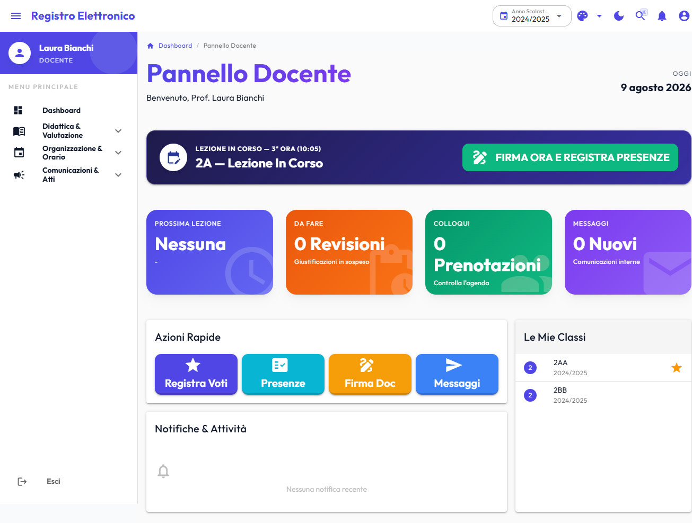
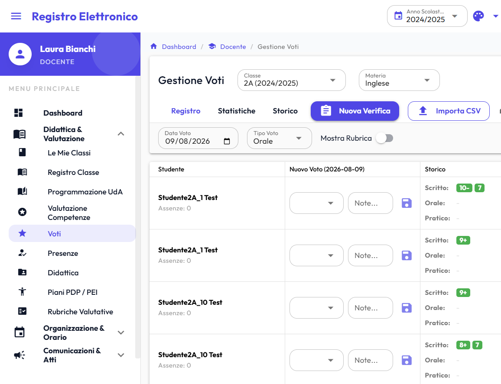
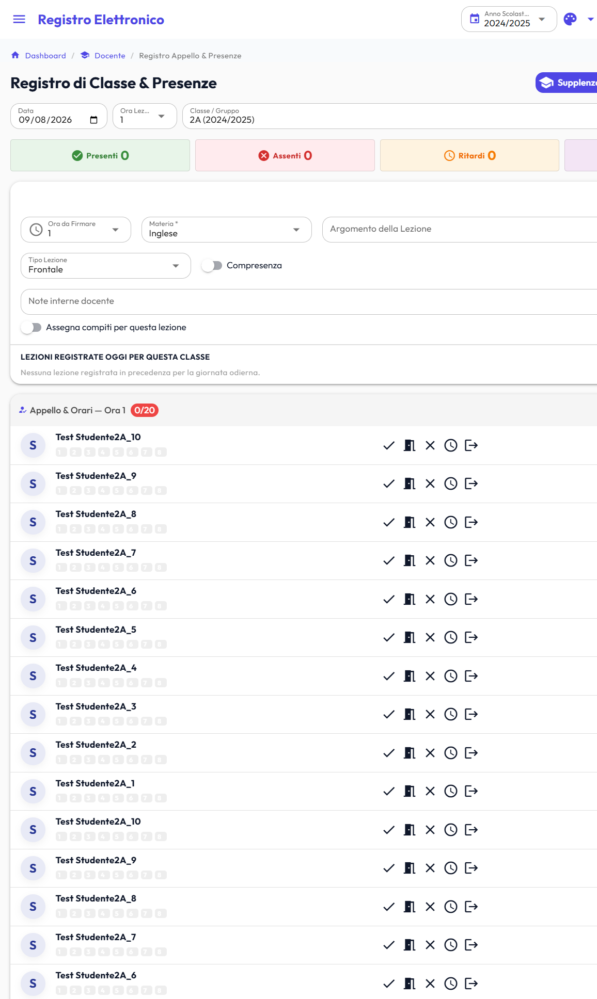
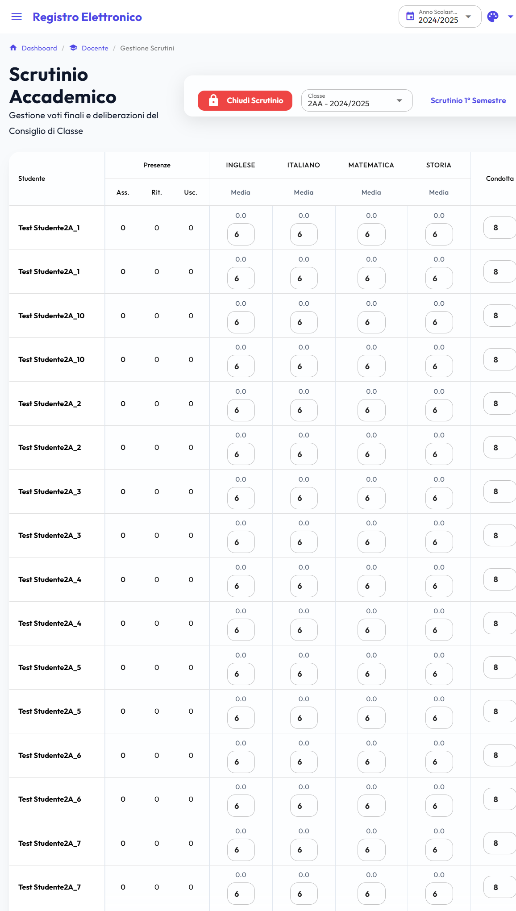
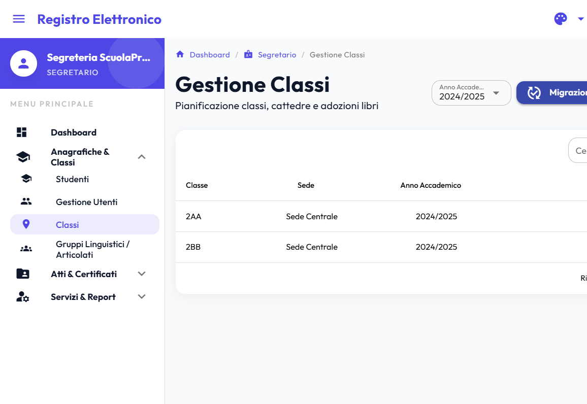
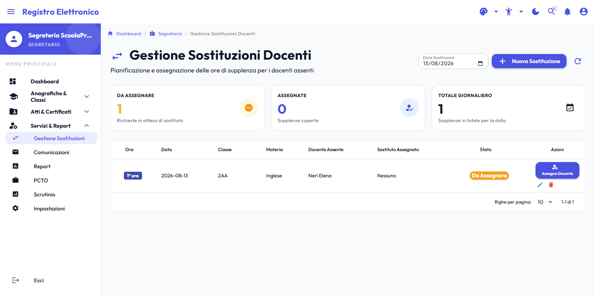
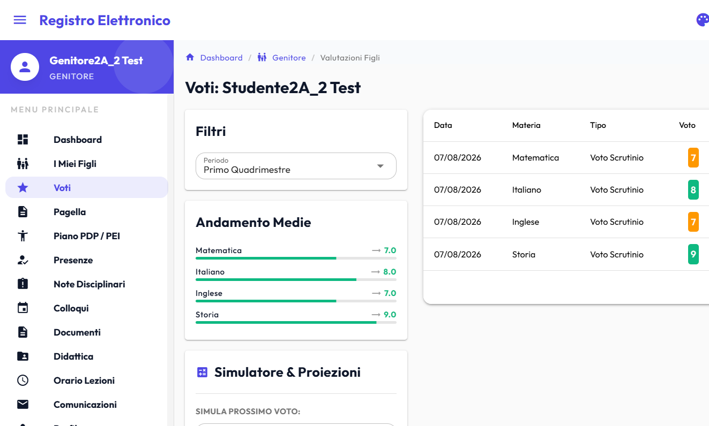

# il_registro — Registro Elettronico Scolastico

> 🏛️ Un registro elettronico **pubblico, aperto e gratuito** per la scuola italiana — ideato e realizzato da un docente, per la scuola pubblica.

> ⚠️ **Stato del progetto**:
> - **Piattaforma Web (Backend Go + Frontend Vue 3)**: **Beta funzionante** — Le funzionalità principali sono operative e testabili tramite la demo online, ma non è ancora consigliata per l'uso in produzione reale.
> - **Applicazioni Mobile Native (Android & iOS)**: **Fase Alpha (Non stabile e incompleta)** — Attualmente in fase di sviluppo attivo e testing iniziale, **non stabili, incomplete e NON idonee all'uso in produzione**.

🇮🇹 **Versione Italiana** | 🇬🇧 **[English Version](./README_EN.md)**

**Online Demo**: [https://registro-scuola.netlify.app](https://registro-scuola.netlify.app)
**Demo accounts & passwords**: [example_account.md](./docs/example_account.md)
_**Nota bene**_: alcune password, come quella per l'account superadmin, potrebbero essere state modificate per motivi di sicurezza.

[](https://discord.gg/Qh5XjQxwb)
[](https://github.com/kimiko88/il_registro/actions/workflows/ci.yml)
[](./publiccode.yml)
[](https://go.dev/)
[](https://vuejs.org/)
[](./LICENSE)
[](https://antigravity.google)
[](https://gemini.google.com)
[](https://anthropic.com)
[](https://github.com/kimiko88/il_registro)
[](https://codecov.io/github/kimiko88/il_registro)
[](https://app.codecov.io/github/kimiko88/il_registro/components)

---

## 📸 Galleria Screenshot

<a href="./docs/images/01_dashboard_teacher.png"></a>

1. **`01_dashboard_teacher.png` — Dashboard Docente & Timeline**
   - _Descrizione_: Vista principale del docente con lezioni del giorno, accessi rapidi ai registri di classe, circolari e notifiche in tempo reale.

<a href="./docs/images/02_grade_matrix_input.png"></a>

2. **`02_grade_matrix_input.png` — Registro Voti & Tastiera Rapida**
   - _Descrizione_: Tabella dei voti con navigazione da tastiera, simulatore voto target e visualizzazione delle misure compensative BES/DSA.

<a href="./docs/images/03_attendance_1click.png"></a>

3. **`03_attendance_1click.png` — Registro Presenze & Firma Ora 1-Click**
   - _Descrizione_: Interfaccia di rilevamento presenze/assenze/ritardi con pulsante di firma rapida della lezione.

<a href="./docs/images/04_scrutiny_matrix.png"></a>

4. **`04_scrutiny_matrix.png` — Matrice di Scrutinio & Pagelle**
   - _Descrizione_: Tabella riepilogativa dello scrutinio di classe con medie per materia, proposte voto e statistiche assenze aggregate.

<a href="./docs/images/05_classes_multisite.png"></a>

5. **`05_classes_multisite.png` — Gestione Classi Multi-Sede**
   - _Descrizione_: Pagina di gestione segreteria con la visualizzazione della Sede scolastica (es. Sede Centrale, Succursale) per ciascuna classe.

<a href="./docs/images/06_substitutions_recommendation.png"></a>

6. **`06_substitutions_recommendation.png` — Gestione Supplenze**
   - _Descrizione_: Gestione delle supplenze con materia e classe (anche con un algoritmo automatico che suggerisce i supplenti).

<a href="./docs/images/07_parent_portal_mobile.png"></a>

7. **`07_parent_portal_mobile.png` — Portale Genitori & PWA Mobile**
   - _Descrizione_: Vista responsive mobile del portale genitori con presa visione circolari, giustifica assenze e libretto voti.

---

## 🏛️ Perché il_registro?

Il sistema scolastico italiano è oggi **dipendente da piattaforme proprietarie e a pagamento** per la gestione del registro elettronico. Questo comporta:

- **Costi ricorrenti** a carico delle scuole pubbliche (e quindi dei contribuenti)
- **Dati sensibili degli studenti** gestiti da soggetti privati, fuori dal controllo pubblico
- **Lock-in tecnologico** che rende difficile cambiare fornitore o personalizzare il sistema

**il_registro nasce come risposta civica a questo problema.**

L'obiettivo è fornire alla _res pubblica_ — scuole, comuni, Stato — uno strumento **migliore di quelli esistenti in commercio**, completamente open-source, che garantisca:

- ✅ **Sovranità del dato**: i dati degli studenti restano in mano pubblica, su infrastrutture controllate dalle istituzioni
- ✅ **Costo zero**: nessuna licenza da pagare, nessun canone annuo, nessun vendor lock-in
- ✅ **Trasparenza**: il codice è pubblico, verificabile e migliorabile dalla comunità
- ✅ **Qualità**: funzionalità avanzate (SPID/CIE, BES/DSA, BI, PWA) tipicamente riservate ai prodotti commerciali

> _"La scuola pubblica merita strumenti pubblici."_

## 👨‍🏫 Autore

**il_registro** è stato ideato e realizzato da **Me ([kimiko88](https://github.com/kimiko88))**, docente di informatica presso una scuola secondaria pubblica di secondo grado.

Il progetto nasce dall'esperienza diretta in aula e dalla necessità quotidiana di disporre di uno strumento di registro elettronico che fosse **aperto, moderno e realmente al servizio della scuola pubblica** — senza costi di licenza e senza cedere i dati degli studenti a soggetti privati.

> _"Da docente, sto provando a costruire lo strumento pubblico e libero che vorrei avere in classe."_

## Panoramica

**il_registro** è un registro elettronico scolastico full-stack progettato per il contesto scolastico italiano. Gestisce voti, presenze, comunicazioni, orari, scrutini, PCTO e molto altro, con supporto nativo a **SPID** e **CIE** per l'autenticazione degli utenti.

Il progetto è organizzato come **monorepo** con backend Go e frontend Vue 3:

```
il_registro/
├── registro-backend/    # API REST in Go (Gin + PostgreSQL + Redis)
├── registro-frontend/   # SPA/PWA in Vue 3 + Quasar
├── android/             # App Native Android (Kotlin Compose: :student, :parent, :teacher, :secretary) [Alpha]
├── ios/                 # App Native iOS (SwiftUI, Xcode + SPM: Studente, Docente, Genitore, Segreteria) [Alpha]
├── docs/                # Documentazione tecnica dettagliata
├── .github/workflows/   # Pipeline CI/CD
├── CHANGELOG.md         # Storico delle versioni
├── CONTRIBUTING.md      # Guida ai contributi
└── SECURITY.md          # Policy di sicurezza
```

il_registro è pensato per essere **auto-ospitato da scuole, Comuni, Regioni o dal Ministero stesso**, abbattendo i costi e riportando la gestione dei dati scolastici sotto controllo istituzionale pubblico.

> 🤖 Questo progetto è stato sviluppato con il supporto di strumenti di intelligenza artificiale (LLM) come ausilio alla scrittura del codice e della documentazione.

---

## Funzionalità principali

| Area                      | Funzionalità                                                                                                                              |
| ------------------------- | ----------------------------------------------------------------------------------------------------------------------------------------- |
| **Guida Sviluppatore**    | **[docs/DEVELOPER_GUIDE.md](./docs/DEVELOPER_GUIDE.md)** (Italiano) & **[docs/DEVELOPER_GUIDE_EN.md](./docs/DEVELOPER_GUIDE_EN.md)** (English): documentazione approfondita su architettura, moduli, RBAC, database e tutorial di estensione |
| **App Mobile Native (Alpha)** | **Android & iOS Native (Fase Alpha non stabile e incompleta)** per Studente, Genitore, Docente e Segreteria (Kotlin Compose & SwiftUI, biometria, offline, 11 lingue) |
| **Autenticazione & SSO**  | JWT RS256 asimmetrico, revoca istantanea JTI su Redis, MFA TOTP, Bcrypt pre-hashing SHA-256 con pepper, rate limit anti-brute force, **Google Workspace & MS Teams SSO** |
| **Ruoli Istituzionali**   | Governance rigorosa su 25 ruoli (Dirigenza, Amministrazione, ATA, Docenti, Famiglie, DPO, Psicologo, Tutor) con matrice RBAC di minimo privilegio |
| **Voti & Valutazioni**    | Inserimento rapido, **Matrix View a Tastiera**, medie ponderate, simulatore voto target, **Matrice Descrittiva O.M. 172/2020 (4 livelli ministeriali)**, misure BES/DSA |
| **Presenze & Lezioni**    | Registro giornaliero, **Firma Ora 1-Click**, firma rapida lezioni consecutive (2-3h), copia argomenti ultima lezione, alert assenteismo  |
| **Atti Ufficiali (PDF)**  | **Registro Personale del Docente PDF** (quadrimestri, medie pesate, lezioni), **Giornale di Classe Mensile PDF** con matrice presenze codificata (P, A, R, U, G) |
| **Monte Ore Docenti CCNL**| **Art. 29 CCNL 40+40 Ore**: tracciamento automatico attività collegiali (lettera A) e consigli di classe (lettera B), permessi brevi e ore di recupero |
| **Sanità & Infortuni**    | **Registro Somministrazione Farmaci** (piano terapeutico ASL, consensi) e **Registro Infortuni con trasmissione telematica INAIL**       |
| **Competenze & INVALSI**  | **Certificazione Competenze D.M. 14/2024** (8 competenze europee, livelli A-D) e **Dashboard Analitica Prove INVALSI** (confronto RAV)  |
| **Pass Fuori Classe**     | **Pass Digitale Uscita Aula** con timer permanenza, tabellone live monitoraggio corridoi per collaboratori scolastici ATA e **Deleghe Ritiro Minori** |
| **Compiti & Consegne**    | **Consegna Elaborati Studente & Correzione Docente Canvas** con rubriche analitiche e sincronizzazione automatica su Google Classroom    |
| **Progetti PNRR Futura**  | **Monitoraggio PNRR Scuola 4.0**: anagrafica progetti, CUP, target, milestone, iscrizione percorsi e registri lezioni rendicontabili     |
| **Scuola dell'Infanzia**  | **Registro Infanzia & Diario di Bordo Fotografico**: appello pasti/diete speciali, riposo pomeridiano, osservazioni per campi d'esperienza |
| **Sostegno & Inclusione** | **Registro Sostegno, PEI (D.I. 182/2020)** su 4 dimensioni ministeriali, verbali riunioni GLO con firme congiunte e quantificazione ore settimanali |
| **PDP (BES & DSA)**       | **Piani Didattici Personalizzati**, misure compensative/dispensative, crittografia AES-256 della diagnosi sanitaria e firma digitale genitore |
| **Supplenze & Dispatcher**| **Tabellone Orario Live (1ª-6ª Ora)** con classi scoperte, raccomandazione automatica supplenti con scoring e assegnazione 1-click        |
| **Personale ATA & Presenze**| **Presenze Personale & Timbrature Badge RFID/NFC**, cartellino mensile 36h CCNL, congedi e **Sportello Digitale Personale** a 3 stadi |
| **Rilevazione Scioperi**  | **Rilevazione Preventiva Scioperi ARAN**: dichiarazioni volontarie del personale, calcolo percentuali d'adesione e avvisi alle famiglie   |
| **Portineria & Visitatori**| **Registro Visitatori di Portineria**, prestiti badge fisici, uscite anticipate alunni con identificazione delegati e segnalazione guasti |
| **Enterprise Hub (MIM)**  | **PagoPA con codici IUV** e riconciliazione OPI/SIOPE+, **Flussi SIDI / MIM** (posizionali e cooperazione applicativa), **Maturità D.M. 88/2020 & Curriculum dello Studente** |
| **Trasparenza & Legalità**| **Albo Pretorio Online (L. 69/2009)** con affissione 15 giorni e timbro digitale, **Amministrazione Trasparente con export ANAC XML**     |
| **Beni & Inventario**     | **Inventario Beni Scolastici D.I. 129/2018**, etichette barcode/QR, registro prestiti e comodati d'uso gratuito per studenti/docenti    |
| **Sportello Psicologico** | **Sportello d'Ascolto (CIC L. 107/2015)** con consenso informato digitale genitori, prenotazione riservata e note cliniche isolate       |
| **Elezioni Digitali**     | **Urna Elettorale Digitale Anonima** per elezioni organi collegiali con scrutinio automatico e certificato                             |
| **Protocollo AgID**       | **Titolario & Protocollo Informatico Ufficiale** con generazione e download del file `Segnatura.xml` interoperabile                      |
| **Portale Famiglia & Studente** | **Monitoraggio Limite Assenze 25% (DPR 122/2009)** con calcolo ore residue, **Planner Compiti & To-Do List** sincronizzato via API |
| **Scrutini & Differiti**  | Tabellone scrutinio, delibere condotta, credito scolastico, **Scrutinio Differito (saldo debiti formativi O.M. 92/2007)**                  |
| **Business Intelligence** | **Dashboard Dispersione Scolastica & Early Warning (DPR 122/2009)**, export piano di supporto CSV, report andamento quadrimestri          |
| **Cloud-Native & Resilienza** | **Kubernetes Probes (`/live`, `/ready`)** con deep dependency check (DB, Redis, goroutine, RAM), **Circuit Breaker** su integrazioni esterne |
| **E-Learning Sync**       | **Google Classroom & Microsoft Teams**: sincronizzazione automatica compiti, voti e classi                                                |
| **Comunicazioni**         | Circolari, comunicazioni urgenti con **Presa d'Atto obbligatoria**, notifiche real-time multicanale (Web Push, WebSocket, Email, SMS)   |
| **Accessibilità & UX**    | **Font DSA OpenDyslexic**, alto contrasto, **Ricerca Globale `Ctrl+K`**, **Toast & Undo (15s)**, Timeline del Giorno, Skeleton screens    |
| **PWA & Offline Outbox**  | Installabile su desktop/mobile (PWA), **Coda Outbox Offline** per operazioni docente con sync FIFO automatico                             |
| **Aule & Multi-Plesso**   | **Gestione Aule Prenotabili nei Vari Plessi**: anagrafica plessi, tipologia e capienza laboratori, disponibilità live e prenotazioni spot/ricorrenti docenti per classe con verifica sovrapposizioni |
| **Generatore Orario (CSP)** | **Motore Intelligente Orario Scolastico**: generazione automatica vincolata (< 30s) per Dirigenza/Vicario, allocazione laboratori nel plesso della classe, rispetto desiderata docenti e priorità basata su anzianità di servizio (`hiring_date`) |

---

## Quick Start

### Prerequisiti

- [Go](https://go.dev/) 1.27+
- [Node.js](https://nodejs.org/) 18+ (LTS)
- [Docker](https://www.docker.com/) e Docker Compose
- [Make](https://www.gnu.org/software/make/)

### Avvio con Docker (consigliato)

```bash
# Clona il repository
git clone https://github.com/kimiko88/il_registro.git
cd il_registro

# Avvia l'intero stack (backend + frontend + DB + Redis)
docker compose up --build
```

- **Backend API**: [http://localhost:8080](http://localhost:8080)
- **Frontend**: [http://localhost:9000](http://localhost:9000)

### Avvio locale (sviluppo)

```bash
# Terminal 1 — Backend
cd registro-backend
cp .env.example .env   # Configura le variabili d'ambiente
make docker-db         # Avvia solo PostgreSQL e Redis
make migrate           # Esegui le migrazioni
make dev               # Avvia con live reload (Air)

# Terminal 2 — Frontend
cd registro-frontend
cp .env.example .env   # Configura VITE_API_URL
npm install
npm run dev
```

---

## ⚙️ Perché Go e Vue.js? (oltre al gusto personale di chi vi scrive)

### Backend — Go

Go è stato scelto per il backend per ragioni che vanno oltre la moda tecnologica:

- **Performance nativa**: Go compila in binari statici con garbage collector a bassa latenza,
  ideale per gestire centinaia di richieste concorrenti (WebSocket, notifiche real-time)
  senza il overhead di una JVM o di un runtime interpretato
- **Semplicità operativa**: un singolo binario da deployare, senza dipendenze runtime —
  perfetto per scuole con infrastruttura IT limitata o per self-hosting su hardware modesto
- **Concorrenza strutturale**: le goroutine rendono naturale gestire operazioni parallele
  (sincronizzazione Google Classroom + notifiche + API) senza la complessità dei thread tradizionali
- **Ecosistema stabile**: a differenza di Node.js o Python, Go ha una compatibilità
  backward garantita — il codice scritto oggi funzionerà tra 10 anni

### Frontend — Vue 3 + Quasar

- **Curva di apprendimento gentile**: Vue è il framework più adottabile da sviluppatori
  scolastici e contributori occasionali, abbassando la barriera ai contributi della community
- **Quasar Framework**: genera nativamente PWA, SPA e app mobile da un'unica codebase —
  fondamentale per supportare dispositivi datati tipici delle scuole pubbliche
- **Reattività granulare**: la Composition API di Vue 3 permette componenti complessi
  (matrix dei voti, scrutinio) senza sacrificare la leggibilità del codice

## Documentazione

| Documento                                                    | Descrizione                                                  |
| ------------------------------------------------------------ | ------------------------------------------------------------ |
| [docs/DEVELOPER_GUIDE.md](./docs/DEVELOPER_GUIDE.md)         | **Guida Completa per lo Sviluppatore (Italiano)**: architettura, layer Go, Pinia, RBAC e tutorial |
| [docs/DEVELOPER_GUIDE_EN.md](./docs/DEVELOPER_GUIDE_EN.md)   | **Complete Developer Guide (English)**: deep-dive architecture, modules, RBAC, tutorial |
| [docs/ABOUT.md](./docs/ABOUT.md)                             | Panoramica, logica librerie esterne, stack e test            |
| [docs/ARCHITECTURE.md](./docs/ARCHITECTURE.md)               | Architettura, layer, pattern, diagrammi data flow            |
| [docs/SETUP_GUIDE.md](./docs/SETUP_GUIDE.md)                 | Installazione locale, Docker, produzione, troubleshooting    |
| [docs/MOBILE_SETUP_GUIDE.md](./docs/MOBILE_SETUP_GUIDE.md)   | Guida configurazione, test e build delle app mobile native  |
| [docs/mobile_instruction.md](./docs/mobile_instruction.md)   | Istruzioni operative e testing delle app mobile e PWA       |
| [docs/FRONTEND_GUIDE.md](./docs/FRONTEND_GUIDE.md)           | Guida sviluppo frontend: componenti, store, routing, testing |
| [docs/API_REFERENCE.md](./docs/API_REFERENCE.md)             | Riferimento API completo con request/response bodies         |
| [docs/example_account.md](./docs/example_account.md)         | Credenziali degli account di prova e seeder                  |
| [registro-backend/README.md](./registro-backend/README.md)   | Guida specifica backend Go                                   |
| [registro-frontend/README.md](./registro-frontend/README.md) | Guida specifica frontend Vue/Quasar                          |
| [android/README.md](./android/README.md)                     | Guida rapida sottomoduli Android                             |
| [ios/README.md](./ios/README.md)                             | Guida rapida target Xcode/SPM iOS                            |
| [CHANGELOG.md](./CHANGELOG.md)                               | Storico versioni e breaking changes                          |
| [CONTRIBUTING.md](./CONTRIBUTING.md)                         | Come contribuire, branch strategy, commit convention         |
| [SECURITY.md](./SECURITY.md)                                 | Segnalazione vulnerabilità, policy GDPR                      |

---

## 🧪 Testing & Qualità

Il progetto include una suite completa di test automatizzati per il backend (Go) e il frontend (Vue/Quasar), integrata con tracciamento granulare della copertura per modulo:

👉 **[Visualizza Componenti Testati su Codecov (Dashboard Moduli)](https://app.codecov.io/github/kimiko88/il_registro/components)**

### Backend Testing (Go)

```bash
# Esegui tutti i test del backend
cd registro-backend && go test ./...

# Esegui i test con rilevatore di race condition
cd registro-backend && go test -race ./...

# Esegui la suite di integrazione
cd registro-backend && go test -v ./tests/integration/...
```

### Frontend Testing (Vitest & Playwright)

```bash
# Unit & Component test con Vitest
cd registro-frontend && npm run test:unit

# Report di copertura dei test
cd registro-frontend && npm run test:coverage

# End-to-End test con Playwright
cd registro-frontend && npx playwright test
```

### Mobile Testing (Android & iOS — Fase Alpha)

```bash
# Test unitari Android (Gradle)
cd android && ./gradlew test

# Test suite iOS (Swift Package Manager)
cd ios && swift test
```

---

## Licenza & Riuso nella Pubblica Amministrazione

Questo progetto — **compreso il backend Go, il frontend web e le applicazioni mobile native per Android e iOS** — è rilasciato sotto licenza **[PolyForm Noncommercial 1.0.0](./LICENSE)** ed è strutturato secondo le **[Linee Guida AgID su acquisizione e riuso del software nella PA (art. 69 CAD)](./docs/AGID_LICENSE_JUSTIFICATION.md)** con il file di metadati **[`publiccode.yml`](./publiccode.yml)** per l'indicizzazione su **Developers Italia**.

> 🏛️ **Uso Gratuito per Scuole e PA**: In conformità alla clausola *Permitted Organizations* della licenza PolyForm, **l'utilizzo per scuole pubbliche, università, Comuni, Regioni ed enti di ricerca è libero, illimitato e a costo zero**.  
> La clausola non-commerciale impedisce a soggetti terzi privati a scopo di lucro di impacchettare o rivendere il software come servizio a pagamento a danno della scuola pubblica.

Per consultare la Relazione Motivazionale ex art. 69 CAD relativa all'eccezione di licenza, si veda **[`docs/AGID_LICENSE_JUSTIFICATION.md`](./docs/AGID_LICENSE_JUSTIFICATION.md)**.

---

## Versionamento & Rilasci

Il versionamento SemVer coordinato tra frontend, backend e metadati AgID è gestito con il comando `npm run bump` (oppure `.\scripts\bump-version.ps1`). Per approfondire, consulta la **[Guida al Versionamento (`docs/VERSIONING.md`)](./docs/VERSIONING.md)**.
